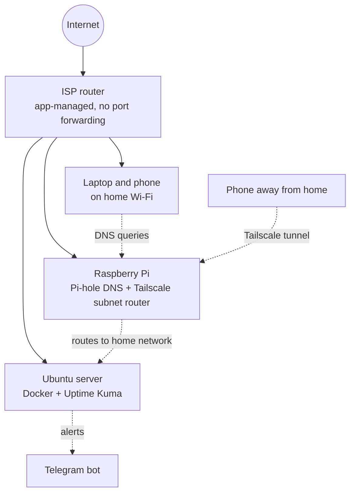

# Second Life Lab

**From dead laptops to a secured, monitored home network.**

A hands-on home lab built from hardware I already owned: two decade-old laptops, a Raspberry Pi 4, and an Arduino from my university projects. Everything here is documented with the steps, the things that broke, and how I fixed them.

## About me

I'm a mechatronics and robotics engineering graduate (MEng) based in the UK, who started a home lab for mental health .For the last four years I've also worked as a carer for  part time , and along the way I became the person people ask to fix things: a TV, a radiator, a printer. I realised that solving practical problems is what I enjoy most, so I turned my old  hardware into a working lab instead of letting it gather dust.

This repo is my record of that. I'm looking for roles in IT support, networking, field engineering, or junior security, and I'm open to freelance work (home networks, monitoring, camera systems).


## What's in here

| # | Project | What it does | Status |
|---|---------|--------------|--------|
| 1 | [Ubuntu home server](docs/01-ubuntu-server.md) | Hardened Linux server on a 2013 laptop, upgraded to 12 GB RAM and an SSD | Done |
| 2 | Pi-hole on a Raspberry Pi | Network-wide ad and tracker blocking, with a fixed IP and firewall | Draft to write |
| 3 | Tailscale private network | Reach my home services securely from anywhere, with no ports opened on the router | Draft to write |
| 4 | Uptime Kuma + Telegram alerts | Monitors devices and messages my phone when something goes down | Draft to write |
| 5 | Security notes | Threat model, hardening checklist, and what is exposed to the internet | Planned |
| 6 | Arduino / Pi sensors and robotics | First hardware project once the network base is solid | Planned |

## Network overview



## Security principles I followed

- **Keys, not passwords.** SSH accepts public-key login only. Password login and root login are off.
- **Default deny firewall.** `ufw` blocks everything inbound except SSH and one dashboard, and only from my home network or the Tailscale interface.
- **Nothing exposed to the internet.** No port forwarding. Remote access goes through Tailscale.
- **Bind services to a specific address.** Docker can bypass `ufw` when a port is published on all addresses, so containers listen on the LAN address only.
- **Separate keys for separate jobs.** One key for the servers and a different one for GitHub. I found the installer had copied my GitHub key onto the server and replaced it with the right one.
- **Backups before changes.** I backed up configs and data before swapping the drive, then restored from the backup.
- **Secrets stay out of Git.** Tokens, keys, and backups are blocked by `.gitignore`, and addresses in these docs are placeholders.

## Hardware

| Device | Role |
|--------|------|
| Acer Aspire E1-571 (2013, Core i3), 12 GB RAM, 240 GB SSD | Home server (Docker, monitoring) |
| Raspberry Pi 4 (4 GB) | Pi-hole and Tailscale subnet router |
| MacBook | Admin workstation |
| Arduino Uno | Reserved for a later sensors and robotics project |

Parts I bought: 8 GB DDR3 SODIMM (£12), 4 GB DDR3 SODIMM (£1), 240 GB 2.5" SATA SSD (£20).

## What went wrong and what I learned

| Problem | Cause | Fix |
|---------|-------|-----|
| Laptop booted Windows, not the USB stick | The F12 boot menu was disabled | Enabled it in the BIOS |
| `@` typed as `"` at the server login | Keyboard layout set to US, keyboard was UK | Set the layout to English (UK) |
| Monitoring went down after a reboot | The router gave the server a new IP, and the container was bound to the old one | Pinned a static IP with `netplan` |
| Network felt like 2G with the VPN on | Pi-hole ignored queries from Tailscale addresses, so lookups timed out | Allowed all origins in Pi-hole, with the firewall still limiting who can reach it |
| A GitHub key appeared on the server | The installer's "import SSH keys" option | Replaced it with a dedicated server key |
| Commands failing for no obvious reason | A missing first letter, a stray full stop, an unclosed quote | 
## Repo layout

```
second-life-lab/
├── README.md
├── docs/            one page per project
├── configs/         sanitised config files (placeholders only)
├── diagrams/        Mermaid sources
└── screenshots/     blurred, no addresses or tokens
```

## Privacy note

This is a public repo, so IP addresses, hostnames, usernames, and tokens in these docs are placeholders such as `<server-ip>`. Nothing here is a credential.

## Licence

MIT. See [LICENSE](LICENSE).
